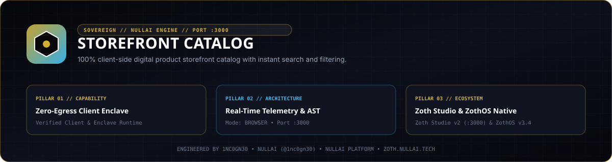

<div align="center">
  
</div>

# YourDigitalSpace POD Showcase (`storefront-catalog`)

Ten Print-on-Demand Etsy product listings with 300 DPI master print canvases, lifestyle mockups, 13-tag SEO sets (`<=20` chars per tag), Printify v1 fulfillment JSON payloads, and a local HTTP catalog server.

- **Repository**: `https://github.com/1nc0gn30/storefront-catalog`
- **Zoth Studio v2 Dossier**: `https://zoth.nullai.tech/tools/storefront-catalog`
- **Local Workstation**: `http://127.0.0.1:8143`
- **Version**: `2.5.0`
- **Author**: 1nc0gn30 (`@1nc0gn30`, `https://1nc0gn30.si`) • NullAI (`https://nullai.tech`)
- **License**: MIT (100% free and open-source; zero paywalls)

---

## Overview

`storefront-catalog` packages a complete 10-listing Etsy Print-on-Demand storefront (`YourDigitalSpace`) targeting botanical, gardening, songbird, tote, digital wall art, and quilting/embroidery craft categories. Every listing is validated by automated unit tests for Etsy title length (`<=140` chars), 13 unique tags (`<=20` chars each), positive net profit after platform and payment processing fees (`62.6%` blended net margin across the 10-item basket), matching Printify variant retail prices in cents, and non-orphan asset files.

### Portfolio Summary

| Metric | Value |
| :--- | :--- |
| **Total Master Listings** | `10` (2 Apparel, 2 Mugs, 2 Totes, 2 Wall Art Packs, 2 Craft Patterns) |
| **Combined Basket Retail** | `$203.41` |
| **Combined Production COGS** | `$52.20` |
| **Combined Net Profit** | `$127.41` |
| **Blended Net Margin** | `62.6%` |

---

## Architecture

```
storefront-catalog/
├── server.py                              # Zero-dependency HTTP daemon & CLI on 127.0.0.1:8143
├── build_catalog.py                       # Synthesizes canvases, mockups, manifest & Printify JSONs
├── build_showcase.py                      # Compiles public/index.html from catalog_manifest.json
├── catalog_manifest.json                  # Canonical 10-product manifest & portfolio financials
├── assets/
│   ├── canvases/                          # 300 DPI master print PNG canvases (10 items)
│   └── mockups/                           # Product lifestyle JPEG mockups (10 items)
├── payloads/                              # Printify v1 API fulfillment JSON payloads (10 items)
├── data/live_drafts.json                  # Ready-to-publish draft bundle
├── bin/
│   ├── storefront-catalog                 # CLI wrapper for server.py
│   └── storefront-catalog-tui             # ZothOS v3.4.0 Unicode U+2800 Braille TUI
├── public/                                # Open-access showcase web app & static payload mirror
└── tests/test_catalog.py                  # Pytest suite verifying Etsy limits, fees & payload parity
```

### REST API Endpoints (`http://127.0.0.1:8143`)

| Method | Path | Description |
| :--- | :--- | :--- |
| `GET` | `/health` (`/api/health`) | Service health, store name, listing count, blended margin, and uptime |
| `GET` | `/api/catalog` | Full `catalog_manifest.json` payload |
| `GET` | `/api/products` | Listings array with 13/13 SEO tags and portfolio financials |
| `GET` | `/api/drafts` (`/api/live-drafts`) | Compiled `data/live_drafts.json` bundle |
| `GET` | `/api/payloads/<product_id>` | Printify v1 JSON payload for a specific product ID |

---

## Quickstart

```bash
git clone https://github.com/1nc0gn30/storefront-catalog.git
cd storefront-catalog

# Launch the catalog server on 127.0.0.1:8143
python3 server.py --port 8143
```

Query the local API from another terminal:

```bash
curl -s http://127.0.0.1:8143/health
curl -s http://127.0.0.1:8143/api/products
curl -s http://127.0.0.1:8143/api/payloads/prod-01-grandma-garden-sweatshirt
```

To rebuild `public/index.html` from `catalog_manifest.json`:

```bash
python3 build_showcase.py
```

---

## CLI & MCP Usage

### CLI Commands (`./bin/storefront-catalog` / `python3 server.py`)

```bash
# Display CLI flags, version, and JSON summary
./bin/storefront-catalog --help
./bin/storefront-catalog --version
./bin/storefront-catalog --status
./bin/storefront-catalog --json

# Bind custom host or port
python3 server.py --host 127.0.0.1 --port 8143
```

### ZothOS v3.4.0 Braille TUI Integration

On ZothOS v3.4.0, `storefront-catalog` and `storefront-catalog-tui` integrate with Zoth Studio v2 (`https://zoth.nullai.tech/tools/storefront-catalog`):

```bash
./bin/storefront-catalog-tui --help
./bin/storefront-catalog-tui --json
```

*(Note: Printify payload generation in `build_catalog.py` pairs with the sibling `etsy-connector` MCP server when regenerating raw canvases from source.)*

---

## Testing & Verification

```bash
python3 -m pytest -q tests/
```

`tests/test_catalog.py` runs 33 parametrized assertions checking:
- Exact 10-item manifest integrity and unique product IDs.
- Etsy `<=140`-character title limits and `<=13` unique `<=20`-character tags per listing.
- Exact fee and net-profit arithmetic (`retail_price - production_cost - marketplace_fees == net_profit`).
- Existence of every referenced canvas PNG, mockup JPEG, and Printify JSON payload with matching retail cent prices.

---

## Support

This catalog and showcase are 100% free and open-source with zero paywalls or feature gates. Optional support: [Buy Us a Coffee (Stripe)](https://buy.stripe.com/3cIfZg27PdKo2D64Ocfw40X).

## License

MIT License — Engineered by **1nc0gn30** (`@1nc0gn30`, `https://1nc0gn30.si`) • **NullAI** (`https://nullai.tech`).
